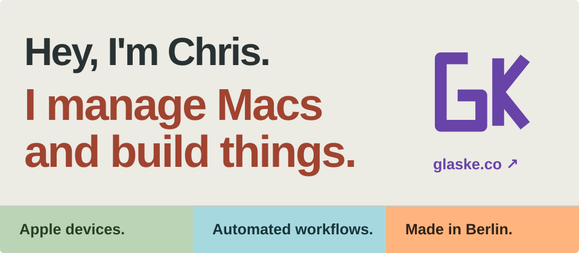

Hi, I'm Chris — an **endpoint management specialist and automation enthusiast** based in **Berlin**.
I build streamlined, scalable solutions to manage and secure device fleets, bridging the gap between endpoint management and automation.

### Devices, workflows, and the code between them.

**Apple device management** — managing and securing device fleets.

**IT process automation** — streamlining the work around them.

  
  
  

---

### Good things start with a conversation.

Automation strategies, Mac admin challenges, or a coffee in Berlin — I'm always happy to connect.

**[Explore my website ↗](https://glaske.co)** · [Projects & tools](https://www.glaske.co/tools.html) · [Say hello](https://www.glaske.co/contact.html)